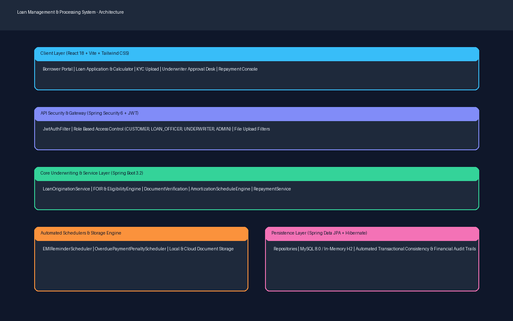
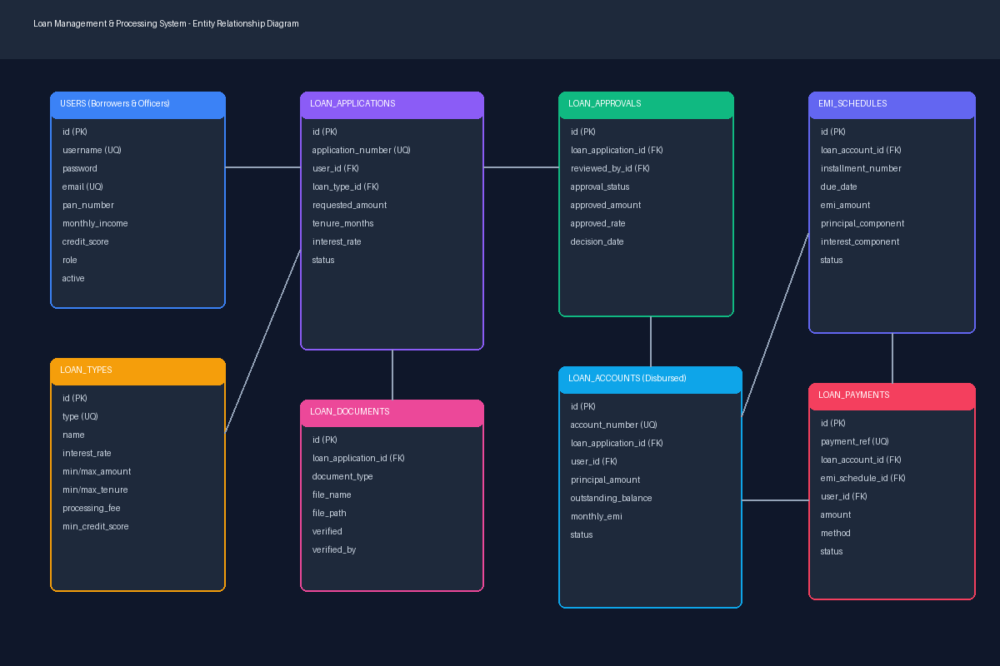
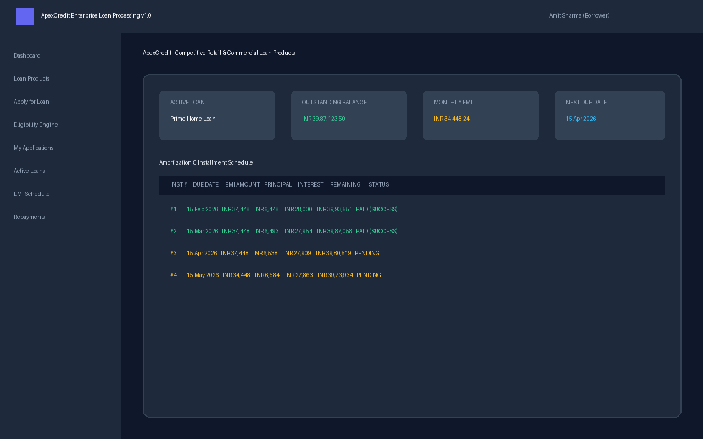
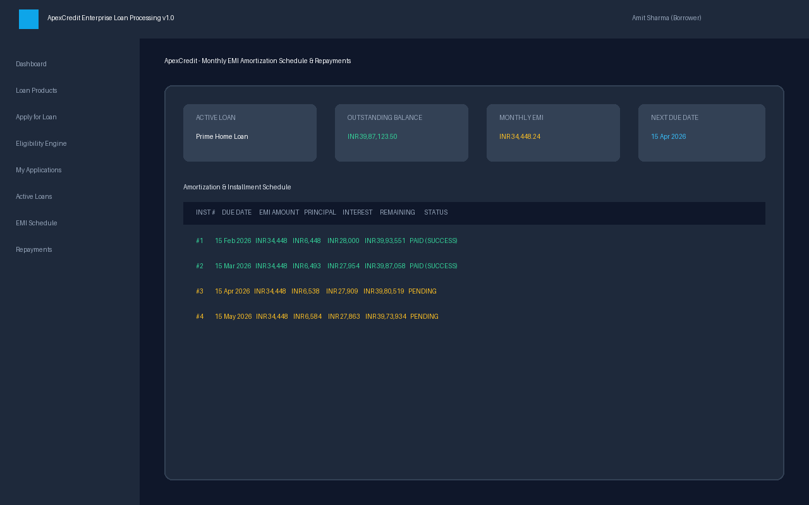

# Loan Management & Processing System (ApexCredit)

[](https://spring.io/projects/spring-boot)
[](https://reactjs.org/)
[](https://vitejs.dev/)
[](https://tailwindcss.com/)
[](LICENSE)

An enterprise-grade, full-stack **Digital Lending & Loan Processing Platform** engineered with **Spring Boot 3**, **Spring Security 6 with JJWT**, **Spring Data JPA**, and **React 18 (Vite + Tailwind CSS)**.

Designed for commercial banks, NBFCs, and fintech lending institutions, ApexCredit handles the complete credit lifecycle: borrower onboarding, automated eligibility and FOIR calculations, KYC document verification, underwriter decision matrices, loan disbursal, reducing-balance EMI amortization schedules, and digital repayments.

---

### 🎓 Professional Upskilling & Enterprise Java Certifications
Accelerate your engineering capabilities in Spring Boot 3 banking microservices, JPA transactions, underwriting algorithms, and reactive ledger architectures with industry-recognized corporate training programs:
- 🚀 **[Java Training Course in Noida](https://uncodemy.com/course/java-training-course-in-noida)** — Hands-on enterprise backend development, Spring Cloud, microservices, and live production banking projects.
- 🚀 **[Java Training Course in Delhi](https://uncodemy.com/course/java-training-course-in-delhi)** — Masterclass on full-stack Java, Hibernate, Kafka, distributed transactions, and 100% placement assistance.

---

## 🏛 System Architecture

The platform follows a clean hexagonal-inspired layered architecture with stateless JWT security, service-oriented business logic, repository abstractions, and scheduled batch tasks.



```
┌──────────────────────────────────────────────────────────────┐
│                  React 18 + Tailwind CSS SPA                 │
│      (Dashboard, Underwriting Desk, EMI Schedule, Ledger)     │
└──────────────────────────────┬───────────────────────────────┘
                               │ REST / JSON (JWT Bearer)
┌──────────────────────────────▼───────────────────────────────┐
│              Spring Boot 3.2.4 REST Controller Layer         │
│  (Auth, LoanType, Applications, Eligibility, Documents,      │
│   Approvals, Accounts, EMI Schedule, Repayments, Admin)      │
├──────────────────────────────────────────────────────────────┤
│              Spring Security 6 + JJWT Filter                 │
├──────────────────────────────────────────────────────────────┤
│               Transactional Service & Business Layer         │
│  (Automated FOIR Engine, Amortization Math, Schedulers)      │
├──────────────────────────────────────────────────────────────┤
│              Spring Data JPA / Hibernate Layer               │
└──────────────────────────────┬───────────────────────────────┘
                               │
                ┌──────────────┴──────────────┐
                ▼                             ▼
       MySQL 8.0 Production          H2 In-Memory Dev/Test
```

---

## 🗄 Entity Relationship Model

The schema captures the real-world operational domain of financial credit products, risk evaluation, documents, and cash flows.



### Key Entities
- **User**: Multi-role accounts (`CUSTOMER`, `LOAN_OFFICER`, `UNDERWRITER`, `ADMIN`) with credit scores and income.
- **LoanType**: Configurable credit products (`HOME_LOAN`, `PERSONAL_LOAN`, `AUTO_LOAN`, `EDUCATION_LOAN`, `BUSINESS_LOAN`).
- **LoanApplication**: Submitted borrowing requests with requested tenure, purpose, and underwriting status.
- **LoanDocument**: Multipart KYC records (`PAN_CARD`, `AADHAAR_CARD`, `SALARY_SLIP`, `BANK_STATEMENT`, `ITR`).
- **LoanApproval**: Credit underwriter reviews, FOIR calculations, risk tiering, and credit limit allocations.
- **LoanAccount**: Core ledger account created upon disbursement with reducing principal balance tracking.
- **EMISchedule**: Monthly installment amortization schedule (Principal vs Interest breakdown and overdue status).
- **LoanPayment**: Repayment audit trail with digital transaction receipts and payment method logs.

---

## 📸 System Screenshots

| Screen | Description | Preview |
|---|---|---|
| **Borrower Dashboard** | Summary of sanctioned accounts, active EMIs, and quick actions |  |
| **Loan Products Catalog** | Product comparison, minimum CIBIL score, and interest ranges |  |
| **Digital Application** | Multi-step loan application with validation |  |
| **FOIR Eligibility Calculator** | Real-time maximum borrowing eligibility based on net income |  |
| **Underwriting Desk** | Credit officer review queue, approval/rejection with remarks |  |
| **EMI Amortization Schedule** | Reducing balance schedule with instant payment modal |  |

---

## ✨ Core Features

### 1. Loan Products & Portfolio Management
- Pre-configured loan types with configurable interest rates (Fixed/Floating), tenures, and maximum sanction amounts.
- Supports Home Loans (8.5%), Auto Loans (9.2%), Personal Loans (12.5%), Education Loans (9.8%), and Business Loans (14.0%).

### 2. Underwriting & Automated FOIR Engine
- Implements standard **Fixed Obligation to Income Ratio (FOIR)** underwriting models.
- Recommends max monthly EMI capacity (up to 50% FOIR threshold for prime borrowers).
- Assesses applicant risk based on CIBIL score brackets:
  - `750 - 900`: Low Risk (Auto-eligible for lowest interest band)
  - `650 - 749`: Medium Risk (Standard terms)
  - `< 650`: High Risk (Subject to senior underwriter exception)

### 3. Paperless KYC & Document Storage
- Secure multipart file upload for PAN, Aadhaar, salary slips, and 6-month bank statements.
- Document validation, size constraints, and MIME-type verification.

### 4. Amortization & Repayment Engine
- Generates reducing-balance amortization schedules with standard banking formula:
  $$EMI = \frac{P \times r \times (1+r)^n}{(1+r)^n - 1}$$
- Detailed split of monthly payment between principal reduction and accrued interest.
- Interactive repayment simulation supporting UPI, Net Banking, and Debit Cards with immediate balance reduction.

### 5. Automated Background Schedulers
- `@Scheduled(cron = "0 0 0 * * ?")`: Scans for unpaid installments exceeding the grace period and flags them as `OVERDUE`.
- Daily reminder scheduler alerting borrowers 3 days prior to EMI due date.

---

## 👥 Default Demo Credentials

All test accounts use the password: **`password123`**

| Username | Role | Full Name | Description |
|---|---|---|---|
| `admin` | `ADMIN` | Vikramaditya Sharma | System Administrator & Chief Risk Officer |
| `officer` | `LOAN_OFFICER` | Ananya Sengupta | Senior Loan Underwriter |
| `john_doe` | `CUSTOMER` | Johnathan Doe | Prime borrower with active Home Loan |
| `priya_sharma`| `CUSTOMER` | Priya Sharma | Applicant with active Personal Loan |

---

## 🚀 Getting Started

### Prerequisites
- **Java**: JDK 17 or higher (`java -version`)
- **Node.js**: Node.js 18+ and npm (`npm -version`)
- **Maven**: Maven 3.8+ (or included wrapper)
- **MySQL** *(Optional)*: MySQL 8.0 server (H2 in-memory is enabled by default for zero-setup local dev)

---

### Backend Setup (Spring Boot)

1. Navigate to the backend directory:
   ```bash
   cd backend
   ```

2. Build and package the project:
   ```bash
   mvn clean package
   ```

3. Run the Spring Boot application:
   ```bash
   mvn spring-boot:run
   ```
   *The backend will boot on port `8080`. H2 database console is available at `http://localhost:8080/h2-console` (JDBC URL: `jdbc:h2:mem:loandb`, User: `sa`, Password: `password`).*

---

### Frontend Setup (React + Vite + Tailwind)

1. Navigate to the frontend directory:
   ```bash
   cd frontend
   ```

2. Install dependencies:
   ```bash
   npm install
   ```

3. Start development server:
   ```bash
   npm run dev
   ```
   *The application will launch on `http://localhost:3000` with automated proxy to backend port `8080`.*

---

## 📡 REST API Specification

Detailed endpoint documentation is available in [API_Documentation.md](docs/API_Documentation.md).

| Method | Endpoint | Description | Access |
|---|---|---|---|
| `POST` | `/api/auth/register` | Register new borrower account | Public |
| `POST` | `/api/auth/login` | Authenticate and retrieve JWT token | Public |
| `GET` | `/api/auth/me` | Fetch currently logged in user profile | Authenticated |
| `GET` | `/api/loan-types` | List all active loan products | Public |
| `POST` | `/api/applications` | Submit new credit application | Customer |
| `GET` | `/api/applications/my` | View applications for current user | Customer |
| `POST` | `/api/eligibility/check` | Calculate loan eligibility & FOIR | Public / Auth |
| `POST` | `/api/documents/upload` | Upload KYC file for application | Customer / Staff |
| `POST` | `/api/approvals/decision` | Underwriter approve/reject action | Underwriter / Admin |
| `POST` | `/api/accounts/disburse/{id}` | Disburse approved application to account | Admin / Officer |
| `GET` | `/api/accounts/my` | List disbursed loan accounts | Customer |
| `GET` | `/api/emi/schedule/{accountId}` | Fetch monthly amortization table | Customer / Staff |
| `POST` | `/api/payments/repay` | Process EMI repayment | Customer |
| `GET` | `/api/admin/metrics` | Retrieve portfolio KPIs & risk metrics | Admin / Officer |

---

## 📚 Advanced Learning & Engineering Resources

To build high-performance microservices and cloud banking architectures like ApexCredit, explore the specialized training tracks:
- 📖 [Java Training Course in Noida](https://uncodemy.com/course/java-training-course-in-noida)
- 📖 [Java Training Course in Delhi](https://uncodemy.com/course/java-training-course-in-delhi)

---

## 📄 License
This project is licensed under the MIT License.
